<div align="center">

# RH DATA — Sistema de Recursos Humanos

**Programa de escritorio para Windows que te ayuda a buscar personal y guardar su información de forma sencilla.**
Sin internet · Sin cuentas en línea · Tus datos se quedan en tu computadora.


-0078d4)


### [⬇️ Descargar el instalador (última versión)](../../releases/latest)

[Español](#-español) · [English](#-english)

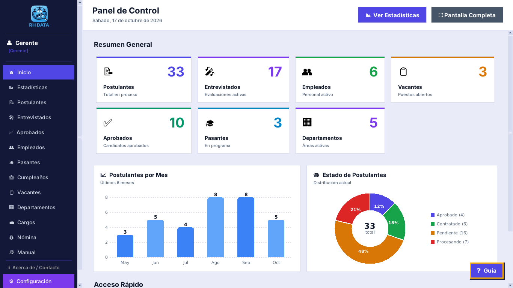

</div>

---

## 🇩🇴 Español

> *«Joven dominicano que quiere facilitar el trabajo de los gerentes de recursos humanos a la hora de buscar personal y guardar su información de manera sencilla.»*

**RH DATA** reúne en un solo programa todo el recorrido de una persona dentro de tu organización: desde que **aplica** a una vacante, pasa por la **entrevista**, es **aprobada**, se convierte en **empleado** y recibe su **nómina**. Todo se guarda en tu propia computadora (base de datos SQLite local): no necesita internet, no envía datos a ningún servidor y no pide crear una cuenta en línea.

### ✨ Qué puedes hacer

| Módulo | Para qué sirve |
|---|---|
| **Postulantes** | Registra candidatos con foto y documentos, genera su hoja de vida en PDF y pásalos a entrevistas. |
| **Entrevistados y mejores postulantes** | Evalúa a cada candidato, compara resultados y mantén una lista corta de los destacados. |
| **Aprobados y empleados** | Confirma la contratación con puesto, departamento y salario; controla asistencia, permisos, vacaciones y amonestaciones. |
| **Documentos y expediente en PDF** | Adjunta cédula, CV, certificados… y saca un PDF listo para imprimir con toda la información de la persona. |
| **Pasantes** | Registra estudiantes en pasantía y controla sus horas. |
| **Vacantes** | Crea puestos de trabajo y genera imágenes PNG con el logo de tu empresa (cuadrada, historia vertical y horizontal) listas para redes sociales, además de documentos PDF. |
| **Departamentos y cargos** | Organiza la estructura de la empresa con sus rangos salariales. |
| **Nómina** | Calcula sueldos con descuentos de ley (**República Dominicana: SFS, AFP e ISR**, por mes o por quincena) y guarda el historial. Reglas de otros 11 países de América incluidas **solo como referencia**. |
| **Cumpleaños** | Tarjetas de felicitación y avisos de Windows incluso con el programa cerrado. |
| **Usuarios y roles** | Gerente, Administrador y Usuario, cada uno con sus permisos. |
| **Respaldos** | Copias de seguridad completas con un clic, con control de integridad. Si algo se daña, reinstalas y recuperas los mismos datos. |
| **Apariencia y ayuda** | 12 temas claros y oscuros, tamaño de letra ajustable, **guía interactiva** paso a paso y **manual de usuario** con buscador. |

### 🖼️ Capturas de pantalla

<table>
  <tr>
    <td align="center">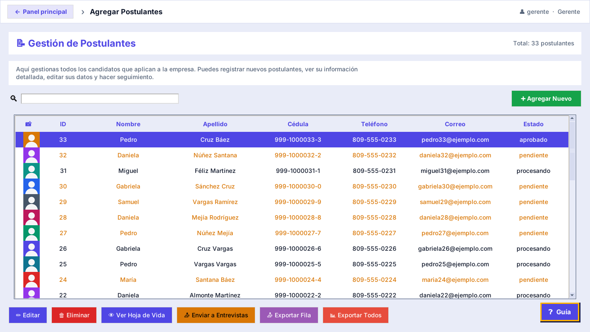<br><sub><b>Postulantes</b></sub></td>
    <td align="center">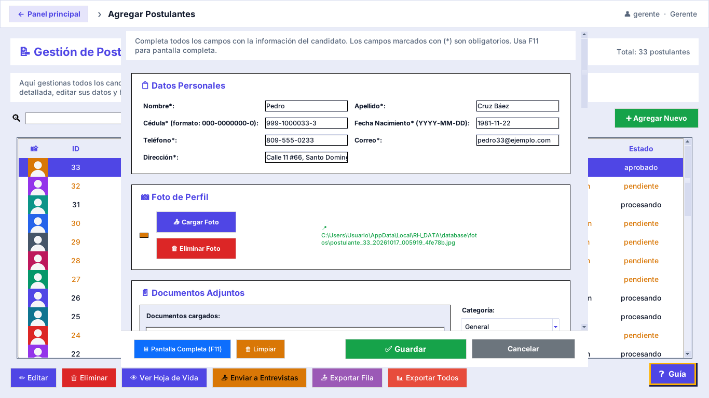<br><sub><b>Registro de un postulante</b></sub></td>
  </tr>
  <tr>
    <td align="center">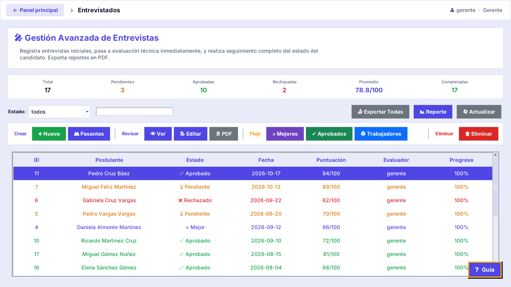<br><sub><b>Entrevistados</b></sub></td>
    <td align="center">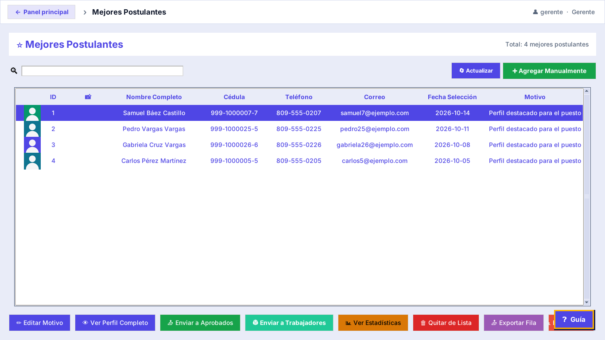<br><sub><b>Mejores postulantes</b></sub></td>
  </tr>
  <tr>
    <td align="center">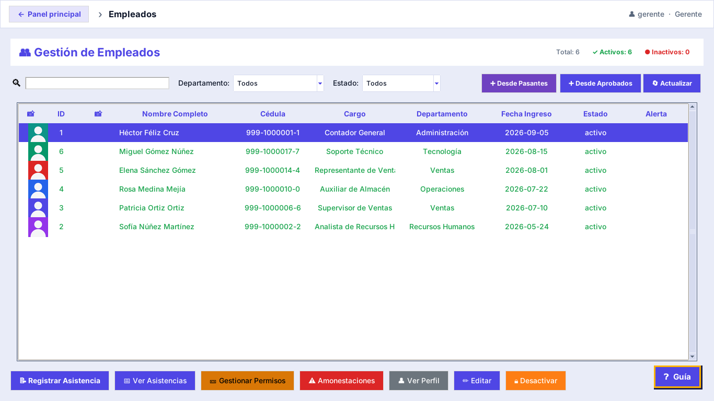<br><sub><b>Empleados</b></sub></td>
    <td align="center">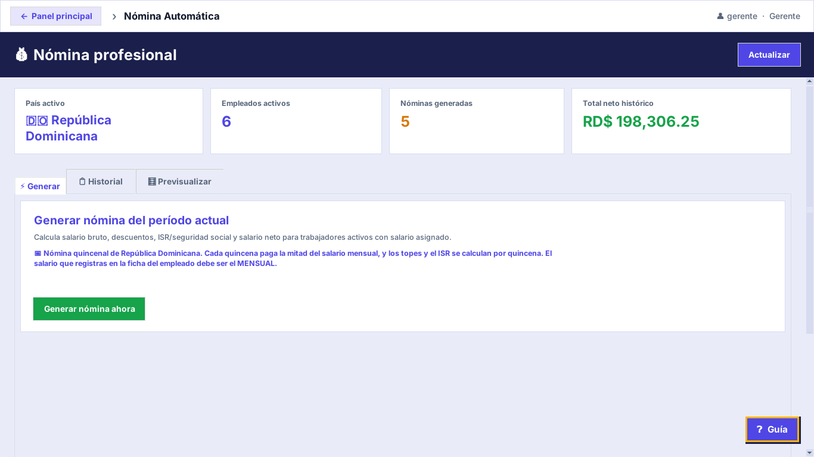<br><sub><b>Nómina</b></sub></td>
  </tr>
  <tr>
    <td align="center">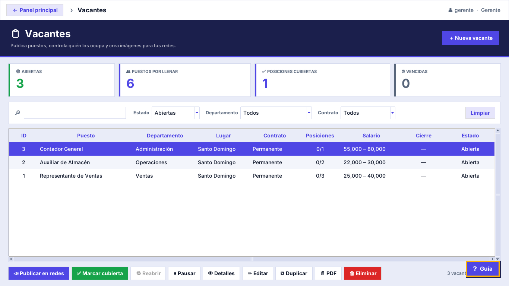<br><sub><b>Vacantes</b></sub></td>
    <td align="center">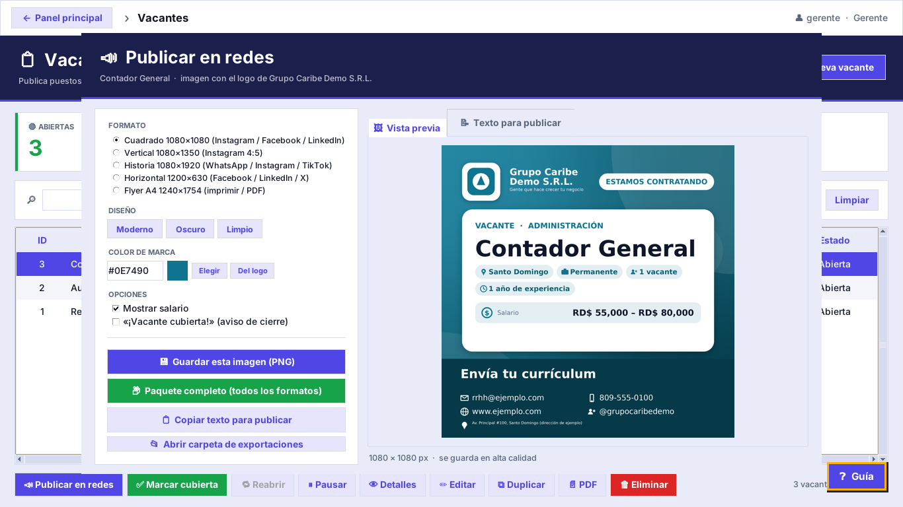<br><sub><b>Imagen de vacante para redes sociales</b></sub></td>
  </tr>
  <tr>
    <td align="center">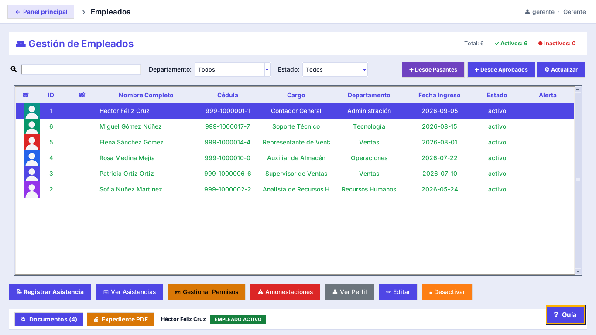<br><sub><b>Documentos y expediente en PDF</b></sub></td>
    <td align="center">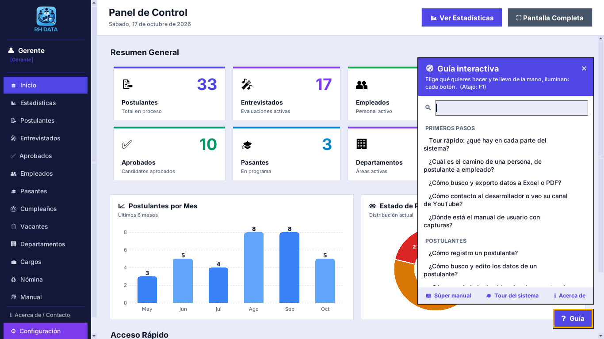<br><sub><b>Guía interactiva paso a paso</b></sub></td>
  </tr>
  <tr>
    <td align="center">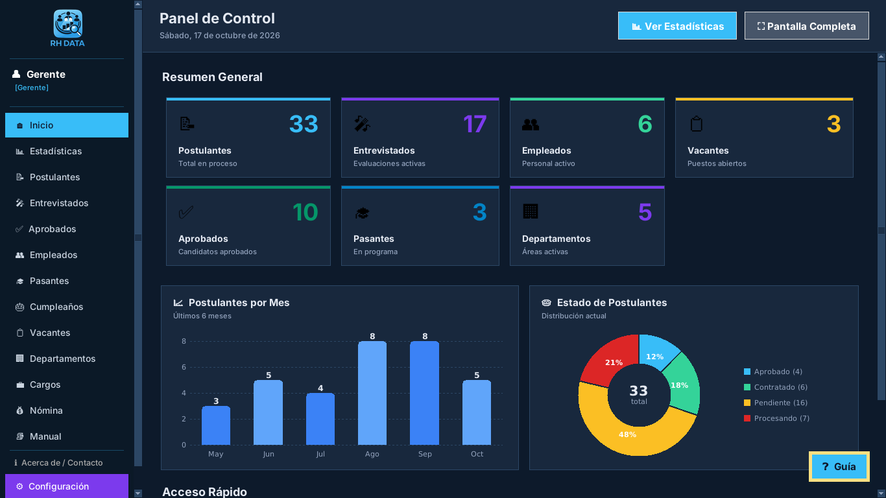<br><sub><b>Tema oscuro (hay 12 temas)</b></sub></td>
    <td align="center">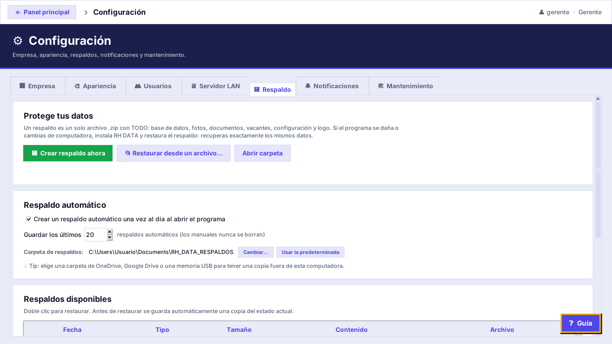<br><sub><b>Respaldo y recuperación</b></sub></td>
  </tr>
  <tr>
    <td align="center" colspan="2">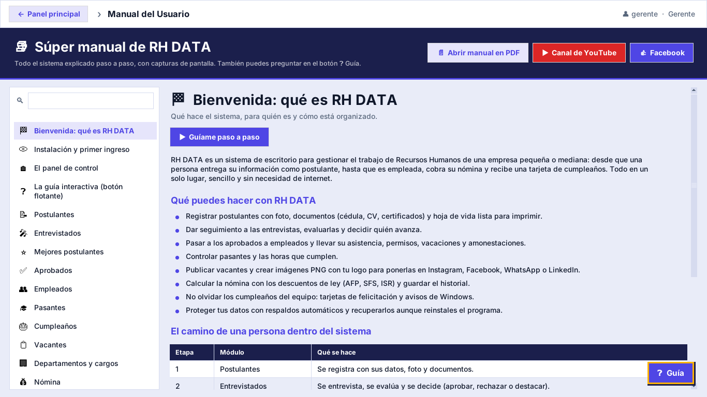<br><sub><b>Manual de usuario integrado, con buscador</b></sub></td>
  </tr>
</table>

> Todas las capturas usan datos ficticios.

### 🆓 Versión gratis y licencia PRO

| | **Gratis (para siempre)** | **PRO (pago único, permanente)** |
|---|---|---|
| Panel y estadísticas | ✅ | ✅ |
| Postulantes, entrevistados, aprobados y empleados | ✅ hasta 15 registros por lista | ✅ sin límite |
| Departamentos / cargos | ✅ hasta 5 / hasta 10 | ✅ sin límite |
| Configuración, respaldos y manual | ✅ | ✅ |
| Nómina automática | — | ✅ |
| Mejores postulantes y pasantes | — | ✅ |
| Vacantes con imagen para redes sociales | — | ✅ |
| Cumpleaños y notificaciones de Windows | — | ✅ |
| Documentos adjuntos y expediente en PDF | — | ✅ |
| Usuarios y roles, servidor en red local (LAN) | — | ✅ |

La licencia PRO es un **código personal para una computadora**. Se obtiene abriendo el menú **🔑 Licencia** dentro del programa, copiando el *ID del equipo* y escribiéndome por Facebook; la activación se comprueba **sin internet**. El programa **nunca pide datos de tarjeta**.

### 📥 Instalación

1. Ve a **[Releases](../../releases/latest)** y descarga `RH_DATA_Instalador_2.0.exe`.
2. Ejecuta el instalador (asistente en español) y sigue los pasos. No necesitas instalar Python ni otros programas.
3. Abre **RH DATA** desde el menú Inicio o el escritorio. Los usuarios iniciales están en el **manual de usuario** (`Manual_Usuario_RH_DATA.pdf`, también disponible en la página del release); cámbialos en *Configuración → Usuarios*.

**Requisitos:** Windows 10 u 11 (64 bits) · unos 60 MB de espacio libre · pantalla de 1366×768 o mayor.

**Verificar la descarga (opcional).** En PowerShell:

```powershell
Get-FileHash .\RH_DATA_Instalador_2.0.exe -Algorithm SHA256
```

Debe coincidir con la huella que aparece en la página del release.

> **ℹ️ Sobre la advertencia de Windows.** El instalador aún **no tiene firma digital de pago**, por lo que Windows SmartScreen o algunos antivirus pueden mostrar un aviso con programas nuevos. Si ocurre, pulsa **«Más información» → «Ejecutar de todas formas»**. El programa funciona sin conexión y no envía tus datos a ningún servidor.

### 🔒 Tus datos y tu privacidad

- Los datos viven en `%LOCALAPPDATA%\RH_DATA` y **se conservan al actualizar, reinstalar o desinstalar** el programa.
- Los respaldos automáticos se guardan en `Documentos\RH_DATA_RESPALDOS` (puedes elegir otra carpeta, por ejemplo una USB o una carpeta sincronizada).
- No recopila ni comparte datos personales, no tiene anuncios ni rastreadores. El envío de correos desde el programa está desactivado de fábrica.
- El programa verifica que sus archivos no hayan sido modificados; si detecta una alteración se bloquea y la licencia de esa computadora se elimina (tus datos no se borran).

### 🙋 Soporte y contacto

- Dudas, sugerencias o problemas: abre un **[Issue](../../issues)** aquí o escríbeme por **[Facebook](https://www.facebook.com/jordy.vasquez.792)**.
- Tutoriales y novedades en **[YouTube — @Tiofive2](https://www.youtube.com/@Tiofive2)**.

### 👤 Autor

Desarrollado por **Jordy Eugenio Vásquez** · *Tío Five YT* — República Dominicana 🇩🇴

© 2026 Jordy Eugenio Vásquez. Todos los derechos reservados. Este repositorio distribuye el programa compilado; el código fuente no está incluido.

---

## 🇺🇸 English

**RH DATA** is a Windows desktop application that helps HR managers and small and medium-sized businesses find staff and keep their information organized — all in one place. Everything is stored **locally on your computer** (SQLite): no internet connection, no online account, no data sent to any server.

### ✨ Features

- **Applicants** — register candidates with photo and documents, generate a résumé sheet in PDF and move them through interviews.
- **Interviews and top candidates** — evaluate each candidate, compare results and keep a shortlist.
- **Approved hires and employees** — confirm hires with position, department and salary; track attendance, leave, vacations and disciplinary notes.
- **Documents and personnel file in PDF** — attach ID, résumé and certificates, and print a single PDF with the person's full file.
- **Interns, job openings, birthdays** — vacancies with ready-to-post PNG images for social media (square, story and horizontal), birthday cards and Windows reminders.
- **Departments and positions** — organize the company structure with salary ranges.
- **Payroll** — salaries with legal deductions and history. **Dominican Republic** rules (SFS, AFP, income tax) are included, monthly or bi-monthly (*quincena*); rules for 11 other countries in the Americas are **for reference only** and should be verified with your accountant.
- **Users and roles** — Manager, Administrator and User, each with its own permissions.
- **Backups** — full backups in one click, with integrity checks; reinstall the program and recover the same data.
- **Easy to learn** — interactive step-by-step guide, built-in searchable user manual, 12 light and dark themes, adjustable font size.

*The interface language is Spanish.* See the screenshots above.

### 🆓 Free version and PRO license

The **free version is free forever** and includes the dashboard, applicants, interviews, approved hires and employees (up to 15 records per list), departments (up to 5), positions (up to 10), settings, backups and the manual. The optional **PRO license** is a one-time payment, permanent and tied to **one computer**: it removes the limits and unlocks payroll, top candidates, interns, job openings, birthdays, attached documents with PDF file, users and LAN server. The license is verified **offline**, and the program never asks for card details.

### 📥 Installation

1. Download `RH_DATA_Instalador_2.0.exe` from **[Releases](../../releases/latest)**.
2. Run the installer and follow the wizard (no Python or other software needed).
3. Launch **RH DATA** from the Start menu. Initial users are listed in the user manual (`Manual_Usuario_RH_DATA.pdf`); change them under *Settings → Users*.

**Requirements:** Windows 10 or 11 (64-bit), about 60 MB of free disk space, screen 1366×768 or larger.

> **ℹ️ Windows warning.** The installer does not have a paid digital signature yet, so Windows SmartScreen or some antivirus tools may show a warning for new programs. Choose **"More info" → "Run anyway"**. RH DATA works offline and does not send your data anywhere.

### 🙋 Support

Open an **[Issue](../../issues)**, message me on **[Facebook](https://www.facebook.com/jordy.vasquez.792)**, or watch tutorials on **[YouTube](https://www.youtube.com/@Tiofive2)**.

Developed by **Jordy Eugenio Vásquez** (*Tío Five YT*), Dominican Republic. © 2026 — all rights reserved. Only the compiled program is distributed here; the source code is not included.
